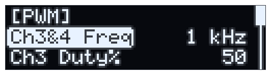
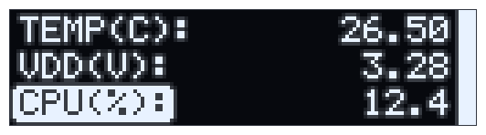

# PWM Tool

基于 **STM32F103C8T6** 的双路 PWM 信号发生器，带 128×32 OLED 图形菜单、频率/脉宽自动扫频、芯片温度与供电电压监测，以及系统资源占用统计。

整套 UI 由两个按键驱动，不需要编码器或触摸屏。


---

## 功能特性

- **双路 PWM 输出**：TIM4 CH3 / CH4，分别对应 PB8 / PB9
- **8 档频率**：100 Hz、200 Hz、500 Hz、1 kHz、2 kHz、5 kHz、10 kHz、20 kHz（两路共用）
- **独立占空比**：0 ~ 100 %，步进 1 %
- **独立输出开关**：每路可单独关闭，关闭时引脚恒为低电平
- **频率扫频**：在任意两个档位之间往返扫频，单程时间 2 / 5 / 10 / 20 / 30 / 60 秒可选
- **脉宽扫频**：两通道各自设置起止占空比，往返扫频，共用单程时间
- **输出安全策略**：离开 PWM / Sweep 页面树时自动停止输出并关闭扫频
- **环境监测**：芯片内部温度传感器 + Vrefint 反推供电电压，每 500 ms 刷新
- **资源统计**：CPU 负载（DWT 周期计数）、RAM 占用率、Flash 占用率
- **显示设置**：亮度 10 %~100 % 可调，60 秒无操作自动进入防烧屏屏保
- **开机自检画面**：验证 OLED 与 SPI 链路正常后再交给 UI

---

## 硬件

| 项目  | 规格                                                       |
| --- | -------------------------------------------------------- |
| 主控  | STM32F103C8T6（Cortex-M3，72 MHz，64 KB Flash / 20 KB SRAM） |
| 显示屏 | SSD1306，128×32 单色 OLED，SPI 接口                            |
| 按键  | 2 个轻触按键（PB0 / PB1），内部上拉，按下为低电平                           |
| 晶振  | 8 MHz 外部晶振，PLL ×9 → 72 MHz                               |
| 调试  | SWD（ST-Link / DAP-Link）                                  |

### 引脚分配

| 引脚   | 功能        | 说明          |
| ---- | --------- | ----------- |
| PB0  | KEY_DOWN  | 下移 / 长按上移   |
| PB1  | KEY_ENTER | 确认 / 长按返回   |
| PB6  | OLED_CS   | 片选          |
| PB7  | OLED_RST  | 复位          |
| PB8  | TIM4_CH3  | PWM 通道 3 输出 |
| PB9  | TIM4_CH4  | PWM 通道 4 输出 |
| PB13 | SPI2_SCK  | 显示屏时钟       |
| PB14 | OLED_DC   | 数据 / 命令选择   |
| PB15 | SPI2_MOSI | 显示屏数据       |

### 外设配置要点

| 外设       | 配置                                                             |
| -------- | -------------------------------------------------------------- |
| 系统时钟     | HSE 8 MHz × PLL9 = 72 MHz，APB1 = 36 MHz，APB2 = 72 MHz          |
| TIM4     | PSC = 0，ARR = 3599，CH3 / CH4 为 PWM1 模式，**OCPolarity 必须为 High** |
| TIM2     | PSC = 7199，ARR = 199 → 20 ms 更新中断（UI 节拍），NVIC 优先级 0            |
| ADC1     | 时钟 = PCLK2 / 6 = 12 MHz，2 个规则通道，采样时间 239.5 周期                  |
| DMA1_CH1 | ADC1 循环模式，半字，内存自增                                              |
| SPI2     | 主机模式，8 位，Mode 0，PCLK1 / 4 = 9 MHz                              |

> **注意**：TIM4 的输出极性必须是 **High**。若配成 Low，占空比会整体反相，而且 `CCR = 0`（输出关闭）会变成恒高电平，负载反而全功率常亮。

---

## 按键操作

| 操作        | PB1（确认）   | PB0（下移） |
| --------- | --------- | ------- |
| 短按        | 确认 / 进入编辑 | 下移一格    |
| 长按 600 ms | 返回上一级     | 上移一格    |

- **列表菜单**：PB0 短按下移，长按上移，光标循环滚动。
- **滚动选择器**（频率、占空比、开关等）：短按 PB1 进入编辑态，光标跳到右侧数值；此时 PB0 短按往后切换选项、长按往前切换；再短按 PB1 退出编辑态。
- **布尔开关**（`FreqSw`、`Anti-burn` 等）：短按 PB1 直接切换。
- 每个页面第一行是 `[页面名]`，选中它并按确认即可返回上一级。

---

## 界面结构

主菜单为 30×24 图标的横向滚动磁贴，共 4 项，选中项整块反色。下面几张图直接用工程里的字模数据渲染，128×32 原始像素放大 4 倍，和实物一致：

| 页面                                   | 预览                                        |
| ------------------------------------ | ----------------------------------------- |
| **主菜单**<br>磁贴横向滚动，选中项整块反色            |               |
| **PWM**<br>两路共用的频率、各自的占空比与输出开关       |                |
| **Sweep**<br>频率扫频、两路脉宽扫频开关，右侧是单选框    |            |
| **Freq Setup**<br>频率扫频的起止档位与单程时间     |  |
| **Duty Setup**<br>两通道各自的起止占空比，共用单程时间 |  |
| **Settings**<br>亮度、防烧屏屏保、统计叠加开关      |      |
| **About（列表底部）**<br>芯片温度、供电电压、CPU 占用率 |            |

列表页最右侧的 5 px 竖条是滚动条，长度表示光标在列表中的位置；`[页面名]` 固定在首行，选中它即返回上一级。

### 效果


### 菜单树

```
Main
├─ PWM
│   ├─ [PWM]          返回
│   ├─ Ch3&4 Freq     100 Hz ~ 20 kHz（两路共用）
│   ├─ Ch3 Duty%      0 ~ 100
│   ├─ Ch3 Out        OFF / ON
│   ├─ Ch4 Duty       0 ~ 100
│   └─ Ch4 Out        OFF / ON
│
├─ Sweep
│   ├─ [Sweep]        返回
│   ├─ FreqSw         频率扫频开关
│   ├─ Freq Setup     → 频率扫频子页
│   ├─ Ch3 DtySw      通道 3 脉宽扫频开关
│   ├─ Ch4 DtySw      通道 4 脉宽扫频开关
│   ├─ Duty Setup     → 脉宽扫频子页
│   ├─ Ch3 Out        OFF / ON
│   └─ Ch4 Out        OFF / ON
│
├─ Settings
│   ├─ [Seting]       返回
│   ├─ Brightness     10 ~ 100
│   ├─ Anti-burn      屏保开关
│   └─ Show Stat      FPS / CPU 叠加显示开关
│
└─ About
    ├─ [About]        返回
    ├─ Device / MCU / OLED / UI / ROM / RAM
    ├─ HW / FW / BL / Build
    ├─ TEMP(C):  xx.xx
    ├─ VDD(V):   x.xx
    ├─ CPU(%):   xx.x
    ├─ RAM(%):   xx.x
    └─ ROM(%):   xx.x
```

### Sweep 子页

**Freq Setup**（频率扫频参数）

| 项目   | 取值                              |
| ---- | ------------------------------- |
| From | 100 Hz ~ 20 kHz                 |
| To   | 100 Hz ~ 20 kHz                 |
| Time | 2 / 5 / 10 / 20 / 30 / 60 秒（单程） |

**Duty Setup**（脉宽扫频参数）

| 项目                | 取值                              |
| ----------------- | ------------------------------- |
| Ch3 From / Ch3 To | 0 ~ 100 %                       |
| Ch4 From / Ch4 To | 0 ~ 100 %                       |
| Time              | 2 / 5 / 10 / 20 / 30 / 60 秒（单程） |

修改起止值或时间后，扫频会自动重置回起点，下一次开启从起点开始。

---

## 实现要点

### PWM 时基

TIM4 固定 **3600 个计数一个周期**（ARR = 3599），频率只通过预分频实现：

```
PSC = 72 MHz / (f × 3600) − 1
CCR = duty% × 36
```

8 个频点全部能整除，PSC 都是整数：

| 频率     | PSC | 频率     | PSC |
| ------ | --- | ------ | --- |
| 100 Hz | 199 | 2 kHz  | 9   |
| 200 Hz | 99  | 5 kHz  | 3   |
| 500 Hz | 39  | 10 kHz | 1   |
| 1 kHz  | 19  | 20 kHz | 0   |

占空比分辨率固定为 1/3600 ≈ 0.028 %，与频率无关。

### 扫频算法

- **频率扫频**：在起止档位对应的 PSC 之间每步 ±1，范围覆盖 PSC 0 ~ 199；到达端点自动折返，循环往复。
- **步进间隔**：`单程毫秒数 / PSC 跨度`，由主循环按实际经过时间累加推进，不依赖中断。
- **关闭扫频**：频率吸附到最近的档位，脉宽停在当前值，保证菜单显示与硬件一致。
- **脉宽扫频**：两通道各自在起止占空比之间每步 1 %，共用同一个单程时间。

### ADC 采样

- ADC 时钟降到 12 MHz（PCLK2 / 6），满足 F103 的 14 MHz 上限。
- Rank1 = 内部温度传感器，Rank2 = 内部参考电压 Vrefint，采样时间均为 239.5 周期。
- 连续转换 + 循环 DMA，缓冲区里始终是最新的两个码值。
- 主循环每 500 ms 取平均，按 F103 数据手册公式换算：

```
Vdda  = 1.20 V × 4095 / Vrefint_raw
Vtemp = Temp_raw × Vdda / 4095
Temp  = 25 °C + (1.43 V − Vtemp) / 4.3 mV
```

### 系统资源统计

- **CPU 负载**：用 Cortex-M3 的 DWT 周期计数器统计主循环单帧耗时，`CPU% = 平均单帧耗时 / 20 ms`。主循环不做帧率限制，UI 动画速度不受影响。
- **RAM / Flash 占用率**：读取 Keil 链接器符号 `Image$$RW_IRAM1$$ZI$$Limit` 与 `Load$$RW_IRAM1$$Limit`，在初始化时算一次。

### 输出安全策略

- `Out = OFF` 时向比较寄存器写 0，引脚保持低电平。
- 一旦离开 PWM / Sweep 页面树（包括进入 `Freq Setup` / `Duty Setup` 子页再返回主菜单），立即关闭两路输出和全部扫频开关，但保留起止值与时间参数。
- 页面切换在 `PwmApp_Poll()` 中检测，比 UI 渲染更早执行，因此切页后的下一帧就已经断电。

---

## 目录结构

```
PWM_Tool/
├─ Core/
│  ├─ Inc/                      CubeMX 生成的头文件
│  ├─ Src/
│  │   ├─ main.c                入口：初始化顺序、主循环
│  │   ├─ tim.c                 TIM2（UI 节拍）/ TIM4（PWM）初始化
│  │   ├─ adc.c / dma.c         ADC1 与 DMA1_CH1
│  │   ├─ spi.c                 SPI2（OLED）
│  │   ├─ gpio.c                引脚初始化
│  │   ├─ stm32f1xx_it.c        TIM2 中断：按键扫描 + UI 节拍
│  │   ├─ pwm_app.c             PWM 输出与扫频逻辑
│  │   ├─ adc_app.c             温度 / 电压采样
│  │   ├─ sys_stat.c            CPU / RAM / Flash 统计
│  │   └─ app_info.c            版本信息
│  └─ Usercode/
│      ├─ OLEDUI/               OLED 驱动 + 菜单框架
│      │   ├─ OLED.c/.h         SSD1306 显示驱动
│      │   ├─ OLED_Fonts.c/.h   字模与 30×24 图标
│      │   ├─ OLED_UI.c/.h      菜单框架（列表 / 磁贴 / 动画 / 选择器）
│      │   ├─ OLED_UI_MenuData.c/.h  本项目全部菜单与页面定义
│      │   └─ key.c/.h          双按键扫描
│      └─ ssd1306/              备用 SSD1306 驱动（当前未参与显示路径）
├─ Drivers/                     STM32F1 HAL 与 CMSIS
├─ MDK-ARM/
│  └─ PWM_Tool.uvprojx          Keil 工程
└─ PWM_Tool.ioc                 STM32CubeMX 工程
```

---

## 编译与烧录

### 环境

- Keil MDK-ARM 5.x
- STM32F1xx HAL Driver（已包含在 `Drivers/`）
- ARM Compiler 5 或 6

### 编译

用 Keil 打开 `MDK-ARM/PWM_Tool.uvprojx`，按 `F7` 编译。

命令行编译：

```bat
UV4.exe -r MDK-ARM\PWM_Tool.uvprojx -o build.log
```

日志中出现 `0 Error(s), 0 Warning(s)` 即为成功。

### 烧录

通过 SWD 接口用 ST-Link 或 DAP-Link 下载 `MDK-ARM/PWM_Tool.axf`。首次上电会显示约 0.8 秒的开机自检画面。

### 资源占用

| 项目           | 大小           | 占比                |
| ------------ | ------------ | ----------------- |
| Code         | 40 762 B     | —                 |
| RO-data      | 3 302 B      | —                 |
| RW-data      | 3 900 B      | —                 |
| ZI-data      | 4 012 B      | —                 |
| **Flash 合计** | **47 964 B** | **73.2 %**（64 KB） |
| **RAM 合计**   | **7 912 B**  | **38.6 %**（20 KB） |

---

## 已知限制

- **两路频率绑定**：CH3 与 CH4 共用 TIM4 的时基，频率必然相同，只有占空比可以独立。要做双频需要把 CH4 换到另一个定时器。
- **扫频密度不均匀**：频率扫频按 PSC 等步进，低频段每个 PSC 对应的频率跨度小、高频段大，因此低频段扫得密、高频段扫得疏。这是 ARR 固定的硬件限制。
- **参数不持久化**：所有设置只存在 RAM 中，掉电后恢复默认值（频率 1 kHz、占空比 50 %、输出关闭、亮度 10 %）。
- **仅两个按键**：没有独立的返回键，返回依赖 PB1 长按 600 ms。
- **`Show Stat` 会遮挡内容**：FPS / CPU 叠加在屏幕左上角（y = 0 与 y = 8），开启后会盖住列表页前两行右侧的数值，查看参数时建议关闭。
- **备用驱动仍参与编译**：`Core/Usercode/ssd1306/` 下的文件仍在工程中，但当前显示路径走的是 `OLEDUI/OLED.c`，可以在 Keil 里移除这两份源文件以节省 Flash。

---

## 许可

本项目使用的 STM32 HAL 驱动与 CMSIS 遵循 STMicroelectronics 的许可条款；`OLED_UI` 菜单框架与 SSD1306 驱动来自各自的开源项目，请遵循其原始许可。
